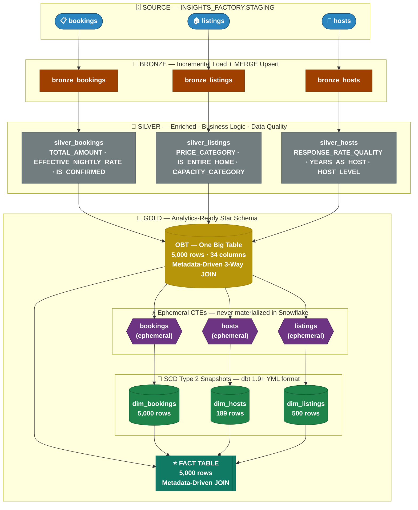

<div align="center">


# Insights_Factory: Production Analytics Pipeline — End-to-End ELT with dbt & Snowflake

**Production-Grade Data Pipeline with Medallion Architecture & Star Schema**

*A fully layered ELT pipeline built on dbt + Snowflake that ingests raw Insights_Factory data, transforms it through Bronze → Silver → Gold layers, and delivers a Star Schema with SCD Type 2 slowly changing dimensions — all metadata-driven, tested, and production-ready.*

---


</div>

---

## Overview

This project is a **production-ready data engineering pipeline** built with **dbt (data build tool)** and **Snowflake**, designed around the Insights_Factory dataset. It implements a full **Medallion Architecture** (Bronze → Silver → Gold) and breaks the Gold One Big Table (OBT) into a proper **Star Schema** with three SCD Type 2 dimension tables and one fact table — all driven by metadata, with zero hardcoded SQL paths, full DAG lineage, and 30 automated data tests passing across every layer.

The pipeline processes **5,000 bookings**, **500 listings**, and **189 hosts** end-to-end, applying business logic, data quality flags, and slowly changing dimension tracking to deliver analytics-ready tables directly in Snowflake.

---

## Table of Contents

- [Architecture](#architecture)
- [Project Structure](#project-structure)
- [Data Flow](#data-flow)
- [Layers In Detail](#layers-in-detail)
  - [Sources — Staging](#sources--staging)
  - [Bronze Layer](#bronze-layer)
  - [Silver Layer](#silver-layer)
  - [Gold Layer — OBT](#gold-layer--obt-one-big-table)
  - [Gold Layer — Star Schema](#gold-layer--star-schema)
- [Snapshots — SCD Type 2](#snapshots--scd-type-2)
- [Macros](#macros)
- [Data Tests](#data-tests)
- [Analyses](#analyses)
- [Tech Stack](#tech-stack)
- [Setup & Installation](#setup--installation)
- [Environment Variables](#environment-variables)
- [How to Run](#how-to-run)
- [Snowflake Objects Created](#snowflake-objects-created)
- [Key Design Decisions](#key-design-decisions)

---

## Architecture



---

## Project Structure

```
AWS_DBT_Snowflake/
│
├── .env                              # ⚠ Secret — DBT_SNOWFLAKE_PASSWORD (git-ignored)
├── .gitignore                        # Ignores profiles.yml, .env, target/, logs/
├── README.md                         # This file
│
└── aws_dbt_snowflake_project/
    │
    ├── dbt_project.yml               # Project config — schema routing, materialization
    ├── profiles.yml                  # Snowflake connection (env_var for password)
    ├── ExampleProfiles.yml           # Safe redacted template for sharing
    │
    ├── models/
    │   ├── properties.yml            # Data tests for bronze, silver, OBT & fact models (8 models total)
    │   │
    │   ├── sources/
    │   │   └── sources.yml           # Source declarations — INSIGHTS_FACTORY.STAGING.*
    │   │
    │   ├── bronze/
    │   │   ├── bronze_bookings.sql   # Incremental passthrough — bookings
    │   │   ├── bronze_listings.sql   # Incremental passthrough — listings
    │   │   ├── bronze_hosts.sql      # Incremental passthrough — hosts
    │   │   └── properties.yml        # Bronze layer notes (config via dbt_project.yml)
    │   │
    │   ├── silver/
    │   │   ├── silver_bookings.sql   # Enriched: TOTAL_AMOUNT, EFFECTIVE_NIGHTLY_RATE, IS_CONFIRMED
    │   │   ├── silver_listings.sql   # Enriched: PRICE_CATEGORY, IS_ENTIRE_HOME, CAPACITY_CATEGORY
    │   │   └── silver_hosts.sql      # Enriched: RESPONSE_RATE_QUALITY, YEARS_AS_HOST, HOST_LEVEL
    │   │
    │   └── gold/
    │       ├── obt.sql               # One Big Table — metadata-driven 3-way JOIN
    │       ├── fact.sql              # Fact table — metadata-driven, joins obt + dim snapshots
    │       └── ephemeral/
    │           ├── bookings.sql      # Ephemeral CTE — feeds dim_bookings snapshot
    │           ├── hosts.sql         # Ephemeral CTE — feeds dim_hosts snapshot
    │           └── listings.sql      # Ephemeral CTE — feeds dim_listings snapshot
    │
    ├── snapshots/
    │   ├── dim_bookings.yml          # SCD2 — unique_key: BOOKING_ID, updated_at: CREATED_AT
    │   ├── dim_hosts.yml             # SCD2 — unique_key: HOST_ID, updated_at: HOST_CREATED_AT
    │   └── dim_listings.yml          # SCD2 — unique_key: LISTING_ID, updated_at: LISTING_CREATED_AT
    │
    ├── macros/
    │   ├── generate_schema_name.sql  # Routes +schema: bronze/silver/gold directly
    │   ├── incremental_filter.sql    # Watermark filter with configurable lookback window
    │   ├── safe_divide.sql           # Division with NULLIF zero-protection
    │   ├── tag.sql                   # 3-level LOW/MEDIUM/HIGH categorization
    │   └── trimmer.sql               # UPPER(TRIM()) data cleansing macro
    │
    └── analyses/
        ├── for_loop.sql              # Jinja for-loop demo
        ├── if_else.sql               # Jinja if-else demo
        └── test.sql                  # Ad-hoc exploration queries
```

---

## Data Flow

```mermaid
flowchart LR
    classDef source   fill:#2E86C1,stroke:#1A5276,color:#fff,font-weight:bold
    classDef bronze   fill:#A04000,stroke:#784212,color:#fff,font-weight:bold
    classDef silver   fill:#717D7E,stroke:#4D5656,color:#fff,font-weight:bold
    classDef obt      fill:#B7950B,stroke:#9A7D0A,color:#fff,font-weight:bold
    classDef ephemeral fill:#6C3483,stroke:#4A235A,color:#fff,font-weight:bold
    classDef snapshot fill:#1E8449,stroke:#145A32,color:#fff,font-weight:bold
    classDef fact     fill:#117A65,stroke:#0E6655,color:#fff,font-weight:bold

    RAW[("🗄️ STAGING\nRaw Source Data\nINSIGHTS_FACTORY")]:::source

    subgraph B["🥉 Bronze Layer"]
        direction TB
        bb[bronze_bookings]:::bronze
        bl[bronze_listings]:::bronze
        bh[bronze_hosts]:::bronze
    end

    subgraph S["🥈 Silver Layer"]
        direction TB
        sb["silver_bookings\n+ TOTAL_AMOUNT\n+ EFFECTIVE_NIGHTLY_RATE"]:::silver
        sl["silver_listings\n+ PRICE_CATEGORY\n+ IS_ENTIRE_HOME"]:::silver
        sh["silver_hosts\n+ RESPONSE_RATE_QUALITY\n+ HOST_LEVEL"]:::silver
    end

    OBT[("🥇 OBT\nOne Big Table\n5,000 rows · 34 cols")]:::obt

    subgraph E["⚡ Ephemeral CTEs"]
        direction TB
        e1{{"bookings"}}:::ephemeral
        e2{{"hosts"}}:::ephemeral
        e3{{"listings"}}:::ephemeral
    end

    subgraph D["📸 SCD2 Dimensions"]
        direction TB
        d1[("dim_bookings\n5,000 rows")]:::snapshot
        d2[("dim_hosts\n189 rows")]:::snapshot
        d3[("dim_listings\n500 rows")]:::snapshot
    end

    FACT[["⭐ FACT TABLE\n5,000 rows"]]:::fact

    RAW -->|"source()"| B
    B -->|"ref()"| S
    S -->|"ref()\nmetadata-driven\n3-way JOIN"| OBT
    OBT -->|"SELECT DISTINCT\nfrom OBT"| E
    E -->|"dbt snapshot\nSCD Type 2"| D
    OBT -->|"ref()"| FACT
    D -->|"ref()\nFK validation"| FACT
```



---

## Layers In Detail

### Sources — Staging

**Location:** `INSIGHTS_FACTORY.STAGING`
**Declared in:** `models/sources/sources.yml`

| Source Table | Primary Key | Tests |
|---|---|---|
| `staging.bookings` | `BOOKING_ID` | unique, not_null |
| `staging.listings` | `LISTING_ID` | unique, not_null |
| `staging.hosts` | `HOST_ID` | unique, not_null |

Raw Insights_Factory data lands here. The dbt `source()` function is used in all bronze models — no hardcoded table paths anywhere in the project.

---

### Bronze Layer

**Schema:** `INSIGHTS_FACTORY.BRONZE`
**Materialization:** Incremental (upsert via Snowflake MERGE)
**Purpose:** Pass raw source data into the warehouse with minimal transformation. Apply incremental watermark filter to process only new/updated records on each run.

| Model | Unique Key | Incremental Filter Column |
|---|---|---|
| `bronze_bookings` | `BOOKING_ID` | `CREATED_AT` |
| `bronze_listings` | `LISTING_ID` | `CREATED_AT` |
| `bronze_hosts` | `HOST_ID` | `CREATED_AT` |

All three models use the `incremental_filter` macro for watermarking. On first run: full load. On subsequent runs: only records newer than `MAX(CREATED_AT) - lookback_days` are processed and upserted.

---

### Silver Layer

**Schema:** `INSIGHTS_FACTORY.SILVER`
**Materialization:** Incremental (upsert via Snowflake MERGE)
**Purpose:** Apply business logic, data type casting, enrichment, data quality flags, and derived columns. This is where raw data becomes trusted, analysis-ready data.

#### `silver_bookings`

| Column | Type | Description |
|---|---|---|
| `BOOKING_ID` | PK | Primary key |
| `LISTING_ID` | FK | Foreign key to listings |
| `BOOKING_DATE` | DATE | Date of booking |
| `CREATED_AT` | TIMESTAMP | Record creation timestamp |
| `NIGHTS_BOOKED` | NUMBER | Duration of stay |
| `BOOKING_STATUS` | VARCHAR | Trimmed + uppercased via `trimmer()` macro |
| `BOOKING_AMOUNT` | FLOAT | Base stay cost |
| `CLEANING_FEE` | FLOAT | Optional cleaning fee |
| `SERVICE_FEE` | FLOAT | Optional service fee |
| `TOTAL_AMOUNT` | FLOAT | `BOOKING_AMOUNT + COALESCE(CLEANING_FEE,0) + COALESCE(SERVICE_FEE,0)` |
| `EFFECTIVE_NIGHTLY_RATE` | FLOAT | `BOOKING_AMOUNT / NIGHTS_BOOKED` (safe divide — no div-by-zero) |
| `IS_CONFIRMED` | BOOLEAN | `TRUE` if `BOOKING_STATUS = 'CONFIRMED'` |

> **Note:** Column was renamed from `PRICE_PER_NIGHT` → `EFFECTIVE_NIGHTLY_RATE` to distinguish from the listing's advertised price, preventing a duplicate column name collision in OBT.

#### `silver_listings`

| Column | Type | Description |
|---|---|---|
| `LISTING_ID` | PK | Primary key |
| `HOST_ID` | FK | Foreign key to hosts |
| `PROPERTY_TYPE` | VARCHAR | Cleaned via `trimmer()` |
| `ROOM_TYPE` | VARCHAR | Cleaned via `trimmer()` |
| `CITY` | VARCHAR | Cleaned via `trimmer()` |
| `COUNTRY` | VARCHAR | Cleaned via `trimmer()` |
| `ACCOMMODATES` | NUMBER | Max guest capacity |
| `BEDROOMS` | NUMBER | Bedroom count |
| `BATHROOMS` | NUMBER | Bathroom count |
| `PRICE_PER_NIGHT` | FLOAT | Advertised nightly rate |
| `PRICE_CATEGORY` | VARCHAR | `LOW / MEDIUM / HIGH` via `tag(PRICE_PER_NIGHT, 100, 200)` |
| `IS_ENTIRE_HOME` | BOOLEAN | `TRUE` if ROOM_TYPE = 'ENTIRE HOME/APT' |
| `CAPACITY_CATEGORY` | VARCHAR | `SOLO/COUPLE / SMALL GROUP / LARGE GROUP / BULK` |
| `PRICE_PER_PERSON` | FLOAT | `PRICE_PER_NIGHT / ACCOMMODATES` (safe divide) |
| `CREATED_AT` | TIMESTAMP | Record creation timestamp |

#### `silver_hosts`

| Column | Type | Description |
|---|---|---|
| `HOST_ID` | PK | Primary key |
| `HOST_NAME` | VARCHAR | Cleaned via `trimmer()` |
| `HOST_SINCE` | DATE | Date host joined |
| `YEARS_AS_HOST` | NUMBER | `DATEDIFF('year', HOST_SINCE, CURRENT_DATE())` |
| `IS_SUPERHOST` | BOOLEAN | Superhost flag from source |
| `RESPONSE_RATE` | FLOAT | Raw response rate percentage |
| `RESPONSE_RATE_QUALITY` | VARCHAR | `VERY GOOD / GOOD / FAIR / POOR` (4-level scale) |
| `HOST_LEVEL` | VARCHAR | `NEW / EXPERIENCED / VETERAN` based on years |
| `CREATED_AT` | TIMESTAMP | Record creation timestamp |

---

### Gold Layer — OBT (One Big Table)

**Schema:** `INSIGHTS_FACTORY.GOLD`
**Materialization:** Table (full rebuild on every run)
**Purpose:** Denormalized analytics table. Joins all three silver models into one wide table for easy querying. Built using a **metadata-driven pattern** — no hardcoded SQL. To add a new table, add a config dict; zero SQL changes needed.

**Rows:** 5,000 | **Columns:** 34

**Full column inventory (from all 3 silver models):**

From `silver_bookings.*`:
`BOOKING_ID, LISTING_ID, BOOKING_DATE, CREATED_AT, NIGHTS_BOOKED, BOOKING_STATUS, BOOKING_AMOUNT, CLEANING_FEE, SERVICE_FEE, TOTAL_AMOUNT, EFFECTIVE_NIGHTLY_RATE, IS_CONFIRMED`

From `silver_listings` (explicit select):
`HOST_ID, PROPERTY_TYPE, ROOM_TYPE, CITY, COUNTRY, ACCOMMODATES, BEDROOMS, BATHROOMS, PRICE_PER_NIGHT, PRICE_CATEGORY, IS_ENTIRE_HOME, CAPACITY_CATEGORY, PRICE_PER_PERSON, LISTING_CREATED_AT`

From `silver_hosts` (explicit select):
`HOST_NAME, HOST_SINCE, IS_SUPERHOST, RESPONSE_RATE, RESPONSE_RATE_QUALITY, YEARS_AS_HOST, HOST_LEVEL, HOST_CREATED_AT`

**Join logic:**
```
silver_bookings
  LEFT JOIN silver_listings  ON silver_bookings.LISTING_ID  = silver_listings.LISTING_ID
  LEFT JOIN silver_hosts     ON silver_listings.HOST_ID      = silver_hosts.HOST_ID
```

---

### Gold Layer — Star Schema

**Schema:** `INSIGHTS_FACTORY.GOLD`

The OBT is decomposed into a Star Schema via three **ephemeral models** that feed **SCD Type 2 snapshots**, plus a **fact table** that joins them all.

#### Ephemeral Models (never materialized in Snowflake — inline CTEs)

| Model | Columns Selected | Feeds Snapshot |
|---|---|---|
| `gold/ephemeral/bookings.sql` | BOOKING_ID, BOOKING_DATE, BOOKING_STATUS, CREATED_AT | `dim_bookings` |
| `gold/ephemeral/hosts.sql` | HOST_ID, HOST_NAME, HOST_SINCE, IS_SUPERHOST, RESPONSE_RATE_QUALITY, HOST_CREATED_AT | `dim_hosts` |
| `gold/ephemeral/listings.sql` | LISTING_ID, PROPERTY_TYPE, ROOM_TYPE, CITY, COUNTRY, PRICE_CATEGORY, LISTING_CREATED_AT | `dim_listings` |

Both `hosts` and `listings` use `SELECT DISTINCT` to deduplicate — one host/listing can appear across many bookings in the OBT.

#### Fact Table — `fact`

**Rows:** 5,000 | **Materialization:** Table

Selects measure and foreign key columns from OBT. Joins dimension snapshots to validate referential integrity. Built metadata-driven — add a new dimension by adding a config dict.

| Column | Source | Description |
|---|---|---|
| `BOOKING_ID` | obt | PK — unique booking identifier |
| `LISTING_ID` | obt | FK → dim_listings |
| `HOST_ID` | obt | FK → dim_hosts |
| `TOTAL_AMOUNT` | obt | Total booking revenue |
| `SERVICE_FEE` | obt | Service fee component |
| `CLEANING_FEE` | obt | Cleaning fee component |
| `ACCOMMODATES` | obt | Listing capacity |
| `BEDROOMS` | obt | Bedroom count |
| `BATHROOMS` | obt | Bathroom count |
| `PRICE_PER_NIGHT` | obt | Advertised listing price |
| `RESPONSE_RATE` | obt | Host response rate |

---

## Snapshots — SCD Type 2

**Location:** `snapshots/`
**Format:** dbt 1.9+ YML-based snapshot config
**Strategy:** Timestamp-based (detects changes via `updated_at` column)
**Schema:** `INSIGHTS_FACTORY.GOLD`

dbt automatically adds these columns to every snapshot table:

| dbt Column | Description |
|---|---|
| `dbt_scd_id` | Surrogate key for each historical row |
| `dbt_updated_at` | When this version was last updated |
| `dbt_valid_from` | When this version became active |
| `dbt_valid_to` | When this version expired (`NULL` = current, or `9999-12-31`) |

`dbt_valid_to_current` is set to `to_date('9999-12-31')` so current records show a concrete sentinel date instead of `NULL`.

| Snapshot | Source (ephemeral) | Unique Key | Updated At | Rows |
|---|---|---|---|---|
| `dim_bookings` | `ref('bookings')` | `BOOKING_ID` | `CREATED_AT` | 5,000 |
| `dim_hosts` | `ref('hosts')` | `HOST_ID` | `HOST_CREATED_AT` | 189 |
| `dim_listings` | `ref('listings')` | `LISTING_ID` | `LISTING_CREATED_AT` | 500 |

**How SCD2 works here:** When a host's record changes (e.g., response rate improves), dbt snapshot:
1. Closes the old row by setting `dbt_valid_to` to the current timestamp
2. Inserts a new row with `dbt_valid_from` = now and `dbt_valid_to` = `9999-12-31`

This preserves full history — you can query what a host looked like at any point in time.

---

## Macros

**Location:** `macros/`

All macros are reusable Jinja-SQL functions that compile into standard SQL at runtime.

### `generate_schema_name`
Overrides dbt's default schema naming behaviour. Without this macro, dbt prepends the target schema (`dbt_schema_`) to custom schema names, producing `dbt_schema_bronze` instead of `bronze`. This macro returns the custom schema name as-is.

```sql
-- Without macro: INSIGHTS_FACTORY.dbt_schema_bronze.bronze_bookings  ❌
-- With macro:    INSIGHTS_FACTORY.BRONZE.bronze_bookings              ✅
```

### `incremental_filter(column, target_table, lookback_days=1)`
Watermark-based incremental filter. Finds the `MAX(column)` in the existing table and filters source records to only those newer than `MAX - lookback_days`. The lookback window catches records that were updated after the last pipeline run.

```sql
-- Usage:
WHERE {{ incremental_filter('CREATED_AT', this) }}

-- Compiles to:
WHERE CREATED_AT >= DATEADD('day', -1,
    (SELECT COALESCE(MAX(CREATED_AT), '1900-01-01'::TIMESTAMP) FROM <this_model>)
)
```

### `safe_divide(numerator, denominator)`
Wraps division in `NULLIF(denominator, 0)` to prevent divide-by-zero errors. Returns `NULL` when denominator is zero instead of crashing.

```sql
-- Usage:
{{ safe_divide('BOOKING_AMOUNT', 'NIGHTS_BOOKED') }}

-- Compiles to:
(BOOKING_AMOUNT / NULLIF(NIGHTS_BOOKED, 0))
```

### `tag(column_name, low, high)`
3-level categorical tagger. Classifies numeric values into `LOW / MEDIUM / HIGH` bands with configurable thresholds.

```sql
-- Usage:
{{ tag('PRICE_PER_NIGHT', 100, 200) }} AS PRICE_CATEGORY

-- Compiles to:
CASE
    WHEN PRICE_PER_NIGHT < 100              THEN 'LOW'
    WHEN PRICE_PER_NIGHT BETWEEN 100 AND 200 THEN 'MEDIUM'
    WHEN PRICE_PER_NIGHT > 200              THEN 'HIGH'
    ELSE 'UNKNOWN'
END AS PRICE_CATEGORY
```

### `trimmer(column_name)`
Applies `UPPER(TRIM())` to column data at SQL runtime. Standardises string data by removing whitespace and uppercasing — important for `BOOKING_STATUS`, `PROPERTY_TYPE`, `ROOM_TYPE`, `CITY`, `COUNTRY`, `HOST_NAME`.

```sql
-- Usage:
{{ trimmer('BOOKING_STATUS') }} AS BOOKING_STATUS

-- Compiles to:
UPPER(TRIM(BOOKING_STATUS)) AS BOOKING_STATUS
```

---

## Data Tests

**Total: 30 tests — all passing (PASS=30 WARN=0 ERROR=0)**

Tests are declared in `models/properties.yml` and `models/sources/sources.yml`.

| Layer | Model | Column Tested | Tests |
|---|---|---|---|
| Sources | `staging.bookings` | BOOKING_ID | unique, not_null |
| Sources | `staging.listings` | LISTING_ID | unique, not_null |
| Sources | `staging.hosts` | HOST_ID | unique, not_null |
| Bronze | `bronze_bookings` | BOOKING_ID | unique, not_null |
| Bronze | `bronze_listings` | LISTING_ID | unique, not_null |
| Bronze | `bronze_hosts` | HOST_ID | unique, not_null |
| Silver | `silver_bookings` | BOOKING_ID | unique, not_null |
| Silver | `silver_listings` | LISTING_ID | unique, not_null |
| Silver | `silver_hosts` | HOST_ID | unique, not_null |
| Gold | `obt` | BOOKING_ID | unique, not_null |
| Gold | `obt` | LISTING_ID | not_null |
| Gold | `obt` | HOST_ID | not_null |
| Gold | `obt` | TOTAL_AMOUNT | not_null |
| Gold | `obt` | HOST_CREATED_AT | not_null |
| Gold | `obt` | LISTING_CREATED_AT | not_null |
| Gold | `fact` | BOOKING_ID | unique, not_null |
| Gold | `fact` | LISTING_ID | not_null |
| Gold | `fact` | HOST_ID | not_null |
| Gold | `fact` | TOTAL_AMOUNT | not_null |

Run tests with:
```bash
dbt test
```

---

## Analyses

**Location:** `analyses/`

These are compiled-but-never-run SQL files used for learning, exploration, and ad-hoc queries. dbt compiles them and validates Jinja/SQL syntax but does not execute them.

| File | Purpose |
|---|---|
| `for_loop.sql` | Demonstrates Jinja `for` loop to dynamically build SELECT columns |
| `if_else.sql` | Demonstrates Jinja `if/else` for dynamic WHERE clause injection |
| `test.sql` | Ad-hoc exploration queries against silver models |

---

## Tech Stack

| Tool | Version | Role |
|---|---|---|
| **dbt Core** | 1.12.6 | Transformation framework — models, snapshots, tests, macros |
| **dbt-snowflake** | 1.12.4 | Snowflake adapter for dbt |
| **Snowflake** | — | Cloud data warehouse — compute + storage |
| **Python** | 3.13 | Runtime for dbt |
| **uv** | latest | Python package manager / virtual environment |

**Snowflake Configuration:**

| Setting | Value |
|---|---|
| Account | `VOQDXVU-XK21252` |
| Database | `INSIGHTS_FACTORY` |
| Role | `ACCOUNTADMIN` |
| Warehouse | `COMPUTE_WH` |
| Threads | 1 |
| Target Schema | `dbt_schema` (overridden per layer via `generate_schema_name`) |

---

## Setup & Installation

### Prerequisites
- Snowflake account with `INSIGHTS_FACTORY` database and `STAGING` schema populated
- Python 3.13+
- `uv` package manager

### 1 — Clone and create virtual environment

```bash
git clone <your-repo-url>
cd AWS_DBT_Snowflake

# Create virtual environment
uv venv .venv --python 3.13

# Activate
source .venv/bin/activate          # macOS/Linux
.venv\Scripts\activate             # Windows
```

### 2 — Install dependencies

```bash
uv pip install dbt-snowflake
```

### 3 — Set up environment variables

Create a `.env` file at the project root (it is git-ignored):

```bash
# /Users/<you>/AWS_DBT_Snowflake/.env
DBT_SNOWFLAKE_PASSWORD=your_snowflake_password_here
```

### 4 — Verify connection

```bash
cd aws_dbt_snowflake_project
source ../../.env          # load the password into shell
dbt debug                  # tests Snowflake connection
```

---

## Environment Variables

| Variable | Required | Description |
|---|---|---|
| `DBT_SNOWFLAKE_PASSWORD` | ✅ Yes | Snowflake account password. Injected into `profiles.yml` via `env_var()`. Never hardcoded. |

> ⚠️ **Security:** `profiles.yml` and `.env` are both listed in `.gitignore`. They will never be committed. Use `ExampleProfiles.yml` as a redacted reference template.

---

## How to Run

> **Always activate the virtual environment and load `.env` before running any dbt command.**

```bash
source /Users/<you>/AWS_DBT_Snowflake/.venv/bin/activate
source /Users/<you>/AWS_DBT_Snowflake/.env
cd /Users/<you>/AWS_DBT_Snowflake/aws_dbt_snowflake_project
```

### Full pipeline run (recommended order)

```bash
# Step 1 — Run all models (bronze + silver + gold OBT + gold fact)
dbt run

# Step 2 — Run all SCD2 snapshots (dim_bookings, dim_hosts, dim_listings)
dbt snapshot

# Step 3 — Run all 30 data tests
dbt test
```

### Selective runs

```bash
# Run only OBT (gold layer)
dbt run --select obt

# Run OBT and everything downstream of it
dbt run --select obt+

# Run only the fact table
dbt run --select fact

# Full refresh a model (force full replace, ignore incremental state)
dbt run --full-refresh --select silver_bookings+

# Run a specific snapshot
dbt snapshot --select dim_hosts

# Run only bronze layer
dbt run --select bronze.*

# Run only silver layer
dbt run --select silver.*
```

### Build (run + test together)

```bash
dbt build         # runs all models, snapshots, then all tests in one command
```

---

## Snowflake Objects Created

After a full successful run, these objects exist in Snowflake:

```
INSIGHTS_FACTORY
 ├── STAGING              (pre-existing raw source data)
 │    ├── bookings
 │    ├── listings
 │    └── hosts
 │
 ├── BRONZE               (incremental tables — dbt managed)
 │    ├── BRONZE_BOOKINGS
 │    ├── BRONZE_LISTINGS
 │    └── BRONZE_HOSTS
 │
 ├── SILVER               (incremental tables — dbt managed)
 │    ├── SILVER_BOOKINGS
 │    ├── SILVER_LISTINGS
 │    └── SILVER_HOSTS
 │
 └── GOLD                 (tables + snapshot tables — dbt managed)
      ├── OBT              ← One Big Table (5,000 rows · 34 columns)
      ├── DIM_BOOKINGS     ← SCD2 snapshot (5,000 rows)
      ├── DIM_HOSTS        ← SCD2 snapshot (189 rows)
      ├── DIM_LISTINGS     ← SCD2 snapshot (500 rows)
      └── FACT             ← Fact table (5,000 rows)
```

> **Note:** Ephemeral models (`gold/ephemeral/bookings.sql`, `hosts.sql`, `listings.sql`) are **not materialized** in Snowflake. They are compiled as inline CTEs directly inside the snapshot queries.

---

## Key Design Decisions

### 1. Metadata-Driven Pipelines
Both `obt.sql` and `fact.sql` use a Jinja `configs` list to define tables, columns, aliases, and join conditions. This means **zero SQL code changes** are needed to add a new source table — just add a dict to the list. This pattern is used in both the OBT (3-way JOIN) and the Fact table (adds dim joins).

### 2. `ref()` over Hardcoded Paths
All models use `ref('model_name')` or `source('staging', 'table')` instead of hardcoded `INSIGHTS_FACTORY.GOLD.OBT` paths. This:
- Preserves DAG lineage in dbt's dependency graph
- Makes the project environment-agnostic (works in dev, staging, prod)
- Enables `dbt run --select model+ ` to correctly identify downstream dependencies

### 3. `generate_schema_name` Macro
Without this override, dbt prepends the target schema to all custom schema names (e.g., `dbt_schema_bronze`). The custom macro returns the `custom_schema_name` as-is, producing clean schema names: `BRONZE`, `SILVER`, `GOLD`.

### 4. Incremental Strategy with Lookback Window
Bronze and Silver models use `is_incremental()` + `incremental_filter()` with a 1-day lookback. This means on every incremental run, records from the last day are re-processed. Combined with `unique_key`, Snowflake performs a MERGE (UPDATE existing + INSERT new) — so late-arriving or updated records are always caught without a full reload.

### 5. Ephemeral Models as Snapshot Sources
Snapshots need a clean, deduplicated input. Rather than creating intermediate materialized tables (which would add Snowflake storage cost and pipeline steps), ephemeral models are used. They compile as CTEs directly inside the snapshot query — no extra Snowflake object, no extra run step.

### 6. `DISTINCT` in Ephemeral Hosts and Listings
The OBT contains one row per booking. A host with 50 bookings appears 50 times in the OBT. Without `DISTINCT`, the `hosts` and `listings` ephemeral models would produce duplicate rows, causing the snapshot unique_key constraint to fail. `SELECT DISTINCT` collapses them to one row per entity.

### 7. SCD Type 2 with `dbt_valid_to_current`
By setting `dbt_valid_to_current: "to_date('9999-12-31')"`, current (active) records show a concrete sentinel date instead of `NULL` in the `dbt_valid_to` column. This simplifies analytical queries — instead of `WHERE dbt_valid_to IS NULL`, analysts can use `WHERE dbt_valid_to = '9999-12-31'`.

### 8. `EFFECTIVE_NIGHTLY_RATE` vs `PRICE_PER_NIGHT`
Both `silver_bookings` and `silver_listings` would produce a column named `PRICE_PER_NIGHT` — one representing what was actually charged per night (derived from booking amount), the other representing the listing's advertised rate. In `silver_bookings`, the derived column is renamed to `EFFECTIVE_NIGHTLY_RATE` to avoid a duplicate column name crash when OBT uses `silver_bookings.*`.

### 9. Security
- Password stored in `.env` → loaded into shell → injected via `env_var('DBT_SNOWFLAKE_PASSWORD')` in `profiles.yml`
- Both `profiles.yml` and `.env` are in `.gitignore` — will never be committed
- `ExampleProfiles.yml` is a redacted template that is safe to commit and share

---

<div align="center">

Built with ❤️ by **Naveed Bhat**


</div>

